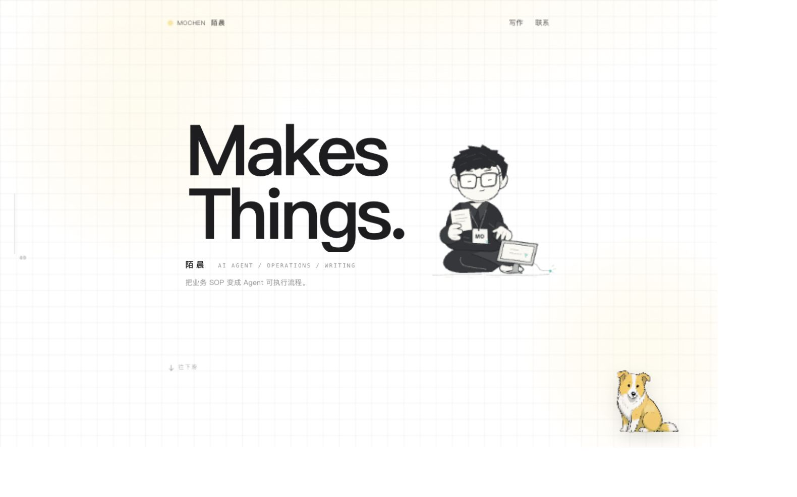

# Mochen Website Design Skill · Portfolio / Writing / Product Websites

[](https://github.com/mochenai/mochen-website-design/stargazers)
[](https://github.com/mochenai/mochen-website-design/releases/latest)
[](LICENSE)
[](https://github.com/mochenai/mochen-website-design/actions/workflows/pages.yml)

[](skills/mochen-website-design/SKILL.md)
[](https://mochenai.github.io/mochen-website-design/)
[](#install-and-use)
[](#install-and-use)
[](#run-the-generator-directly)

> 🌐 [简体中文](README.md) | **English**
>
> **Non-commercial only**: Starting with v1.1.0, original code, Skill documentation, and templates are licensed under the [PolyForm Noncommercial License 1.0.0](LICENSE).

Turn articles, notes, biographies, portfolios, or product information into a working website in the Mochen style: a paper-white grid, large charcoal type, pale-yellow accents, and an interactive dog.

**One repository, two ways to use it: install the Skill to build your own website, or explore Mochen's complete website as a live example.**

- [Mochen website · Live example](https://mochenai.github.io/mochen-website-design/)
- [Skill guide and generated example](https://mochenai.github.io/mochen-website-design/works/website-design-skill/) · Chinese
- [Skill source](skills/mochen-website-design/SKILL.md)

## Project details

| Label | Details |
| --- | --- |
| Project type | Agent Skill / static website generator |
| Use cases | Personal websites, portfolios, article collections, product pages, knowledge pages |
| Supported tools | Codex, Claude Code, and tools compatible with Agent Skills |
| Input | JSON, Markdown, TXT; use your AI tool to extract PDF, DOCX, or image content first |
| Output | Editable HTML + CSS + JavaScript, ready for independent hosting |
| Runtime | Python 3.9+, standard library only; no API key or npm build required |
| Interactions | Search, filters, full-text reading, preserved return state, motion, draggable dog |
| Deployment | GitHub Pages, checked and updated automatically on pushes to main |
| Documentation | Simplified Chinese / English |
| License | Non-commercial only, PolyForm Noncommercial 1.0.0 |

## Install and use

Install in Codex, Claude Code, or another tool that supports Skills:

```bash
npx skills add mochenai/mochen-website-design --skill mochen-website-design
```

To use it across all your Codex projects:

```bash
npx skills add mochenai/mochen-website-design --skill mochen-website-design --agent codex --global
```

Alternatively, [download the v1.1.0 Skill package](https://mochenai.github.io/mochen-website-design/downloads/mochen-website-design-1.1.0.zip), extract it, and run this from its parent directory:

```bash
npx skills add ./mochen-website-design --skill mochen-website-design --agent codex --global
```

Then ask your AI tool:

```text
Use $mochen-website-design to turn the following content into a website in the Mochen style:

(Paste your articles, notes, or project descriptions, or provide file paths.)
```

The content determines the sections. Set your own brand, author, headline, and contact details. The Skill reads the material, organizes the pages, implements the interactions, and starts a local preview. Your AI tool extracts PDF, image, or DOCX content first; the generator accepts JSON, Markdown, and TXT directly. The generated website itself does not call an AI API.

## Run the generator directly

Requires Python 3.9+. No third-party Python dependencies, API key, or npm build:

```bash
git clone https://github.com/mochenai/mochen-website-design.git
cd mochen-website-design

python3 skills/mochen-website-design/scripts/build_site.py \
  --input skills/mochen-website-design/assets/example-content.json \
  --output work/my-site-v1

python3 skills/mochen-website-design/scripts/validate_site.py work/my-site-v1
python3 -m http.server 8787 --bind 127.0.0.1 --directory work/my-site-v1
```

Open http://127.0.0.1:8787/ . Choose a new output directory: the generator refuses to overwrite an existing one. Replace `--input` with your Markdown or JSON file. See the [content schema](skills/mochen-website-design/references/content-schema.md) for JSON fields.

## Included interactions

- Entrance and scroll motion, card hover and click feedback, section transitions, character breathing, blinking, and gaze tracking.
- Search, category filters, full-text reading, and a return action that preserves the query, filters, and scroll position.
- Gaze-Dog head tracking; drag to move, persistence after refresh, double-click or Home / Enter to reset, and arrow keys to reposition.
- Desktop and mobile layouts, system reduced-motion preferences, and `?motion=reduce`.

## Mochen is the complete example



[examples/mochen](examples/mochen) contains Mochen's six projects, 118 articles, six work experience entries, and a real Skill guide and download page. The reusable Skill package includes the template, generator, design references, and neutral sample content. The author's biography and article collection are separate example content.

Preview the complete example locally:

```bash
python3 -m http.server 8787 --bind 127.0.0.1 --directory examples/mochen
```

## Repository layout

```text
skills/mochen-website-design/  Installable Skill, templates, and generator
examples/mochen/              Mochen's complete website example
scripts/build_pages.py        Build the example for GitHub Pages
scripts/check_site.py         Validate articles, assets, and page links
scripts/package_skill.py      Package the Skill with its license files
.github/workflows/pages.yml   Automatic checks and deployment
docs/github-pages.md          Deployment and update guide
README.md                     Simplified Chinese documentation
LICENSE / NOTICE              Noncommercial terms and required notices
```

GitHub Pages publishes the website example at the repository's Pages root URL. The build copies `examples/mochen/`; pushes to `main` trigger checks and deployment. See [GitHub Pages deployment](docs/github-pages.md) for the full workflow.

## License and attribution

**Source is available for non-commercial use only.** Starting with **v1.1.0**, original code, Skill documentation, templates, and derivative code based on these templates are licensed under the [PolyForm Noncommercial License 1.0.0](LICENSE).

- Personal study, research, experiments, and non-commercial projects are permitted as specified in the full license.
- Paid website development, commercial client delivery, commercial business operations, selling or reselling the Skill, and other commercial uses are prohibited.
- Keep [LICENSE](LICENSE) and [NOTICE](NOTICE) when sharing, modifying, or distributing copies. The generator includes both files in generated websites.

Previously published MIT releases, including v1.0.1 and earlier, remain under their original licenses. The new noncommercial terms do not retroactively revoke those grants.

Mochen's articles, biography, name, and personal example content remain the author's property; replace them with your own material. The upstream dog component and sprites retain their original terms; see [third-party notices](THIRD_PARTY_NOTICES.md). The design language references [oiloil.org](https://www.oiloil.org/), and the dog component comes from [Mr-xue/Gaze-Dog](https://github.com/Mr-xue/Gaze-Dog).
