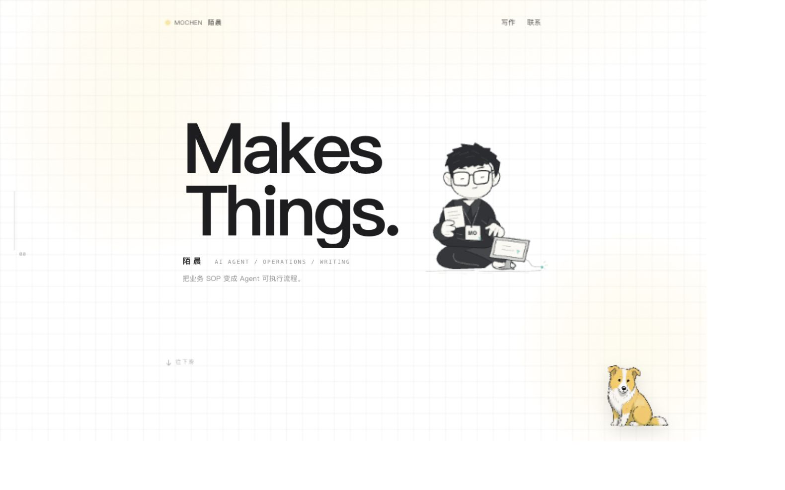

# 个人网站设计 Skill · 作品集 / 写作 / 产品网站

[](https://github.com/mochenai/mochen-website-design/stargazers)
[](https://github.com/mochenai/mochen-website-design/releases/latest)
[](LICENSE)
[](https://github.com/mochenai/mochen-website-design/actions/workflows/pages.yml)

[](skills/mochen-website-design/SKILL.md)
[](https://mochenai.github.io/mochen-website-design/)
[](#安装并使用)
[](#安装并使用)
[](#不安装-skill-也能运行)

> 🌐 **简体中文** | [English version: README.en.md](README.en.md)
>
> **禁止商用 · Non-commercial only**：从 v1.1.0 起，自有代码、Skill 文档和模板采用 [PolyForm Noncommercial License 1.0.0](LICENSE)。

把文章、笔记、履历、作品或产品资料做成可浏览、可交互的网站，沿用陌晨的纸白网格、炭黑大字、浅黄强调和小狗交互。

**一个仓库，两种用法：安装 Skill 做自己的网站；浏览陌晨网站看完整示例。**

- [陌晨个人网站 · 在线示例](https://mochenai.github.io/mochen-website-design/)
- [Skill 使用页](https://mochenai.github.io/mochen-website-design/works/website-design-skill/)
- [Skill 源码](skills/mochen-website-design/SKILL.md)

## 项目标签与能力

| 标签 | 信息 |
| --- | --- |
| 项目类型 | Agent Skill / 静态网站生成器 |
| 使用场景 | 个人网站、作品集、文章专题、产品介绍、知识页面 |
| 支持工具 | Codex、Claude Code，以及兼容 Agent Skills 的工具 |
| 内容输入 | JSON、Markdown、TXT；PDF / DOCX / 图片先由 AI 工具提取 |
| 生成结果 | HTML + CSS + JavaScript，可继续编辑和独立部署 |
| 运行环境 | Python 3.9+，仅标准库，无 API Key 和 npm 构建要求 |
| 页面交互 | 搜索、分类、全文阅读、返回记忆、动效、可拖动小狗 |
| 在线部署 | GitHub Pages，推送到 main 后自动检查与更新 |
| 文档语言 | 简体中文 / English |
| 使用许可 | 仅限非商用，PolyForm Noncommercial 1.0.0 |

## 安装并使用

在支持 Skills 的 Codex / Claude Code 等工具中安装：

```bash
npx skills add mochenai/mochen-website-design --skill mochen-website-design
```

希望在 Codex 的所有项目中使用，可以安装到全局：

```bash
npx skills add mochenai/mochen-website-design --skill mochen-website-design --agent codex --global
```

也可以 [下载 Skill v1.1.0 安装包](https://mochenai.github.io/mochen-website-design/downloads/mochen-website-design-1.1.0.zip)，解压后在它的父目录运行：

```bash
npx skills add ./mochen-website-design --skill mochen-website-design --agent codex --global
```

然后直接输入：

```text
用 $mochen-website-design，把下面的内容做成陌晨风格的网站：

（粘贴文章、笔记、作品介绍，或提供文件路径）
```

内容决定栏目；品牌、署名、标题和联系方式可以换成自己的。Skill 会读取材料、组织页面、实现交互并在本机预览。PDF、图片、DOCX 等先由所用 AI 工具提取；生成器直接支持 JSON、Markdown 和 TXT。网页本身不调用 AI 接口。

## 不安装 Skill 也能运行

需要 Python 3.9+，没有第三方 Python 依赖，不需要 API Key 或 npm 构建：

```bash
git clone https://github.com/mochenai/mochen-website-design.git
cd mochen-website-design

python3 skills/mochen-website-design/scripts/build_site.py \
  --input skills/mochen-website-design/assets/example-content.json \
  --output work/my-site-v1

python3 skills/mochen-website-design/scripts/validate_site.py work/my-site-v1
python3 -m http.server 8787 --bind 127.0.0.1 --directory work/my-site-v1
```

打开 http://127.0.0.1:8787/ 。输出目录必须是新目录，生成器会拒绝覆盖。把 `--input` 换成自己的 Markdown 或 JSON 即可；JSON 字段说明见 [内容格式](skills/mochen-website-design/references/content-schema.md)。

## 有哪些效果

- 首页与滚动进入、卡片悬停和点击反馈、栏目切换、人物呼吸眨眼和视线跟随。
- 搜索、分类、正文阅读、返回列表，保留搜索条件和滚动位置。
- Gaze-Dog 平滑转头；按住拖动、刷新记忆、双击或 Home / Enter 归位、方向键移动。
- 桌面和手机布局，支持系统减少动态效果和 `?motion=reduce`。

## 陌晨是完整示例



[examples/mochen](examples/mochen) 包含陌晨的六个作品、118 篇文章、六段工作经历，以及真实 Skill 使用页与下载。它是根据本人资料编排的完整网站；通用 Skill 安装包只包含模板、生成器、设计约定与中性示例，不带这份履历和文章库。

在本机预览完整示例：

```bash
python3 -m http.server 8787 --bind 127.0.0.1 --directory examples/mochen
```

## 仓库结构

```text
skills/mochen-website-design/  可安装的 Skill、模板与生成器
examples/mochen/              陌晨个人网站示例
scripts/build_pages.py        只打包示例网站到 Pages
scripts/check_site.py         检查文章、资源和页面入口
scripts/package_skill.py      打包带许可证的 Skill 安装包
.github/workflows/pages.yml   自动检查与部署
docs/github-pages.md          部署和更新方法
README.en.md                  English documentation
LICENSE / NOTICE             非商用许可与必须保留的声明
```

GitHub Pages 将示例发布在仓库网址的根路径。只发布 `examples/mochen/`，不会把其他资料目录发布成网页。推送到 `main` 后自动检查并更新，详见 [GitHub Pages 部署](docs/github-pages.md)。

## 许可与来源

**源码公开，仅限非商业用途。** 从 **v1.1.0** 起，自有代码、Skill 文档、模板及基于模板的衍生代码采用 [PolyForm Noncommercial License 1.0.0](LICENSE)。

- 可以用于个人学习、研究、实验和非商业项目；具体允许范围以许可证原文为准。
- 禁止用于收费建站、商业客户交付、公司商业业务、销售或转售本 Skill，以及其他商业用途。
- 分享、修改和分发时，须保留 [LICENSE](LICENSE) 与 [NOTICE](NOTICE)。生成器会把这两份文件带入生成的网站。

v1.0.1 及之前已发布的 MIT 版本仍按原许可授权；新的非商用许可不追溯撤销此前的授权。

陌晨示例中的文章、履历、名称和个人内容保留作者权利，复用网站时请换成自己的内容。小狗的原始组件及精灵保留上游条款，见 [第三方来源](THIRD_PARTY_NOTICES.md)。设计语言参考 [oiloil.org](https://www.oiloil.org/)，小狗组件来自 [Mr-xue/Gaze-Dog](https://github.com/Mr-xue/Gaze-Dog)。
